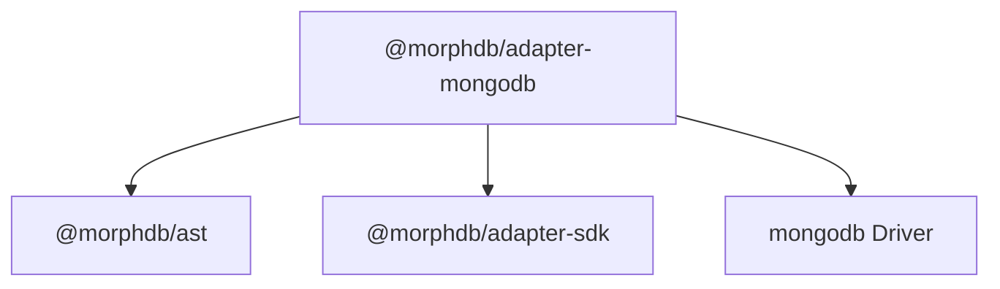

# `@morphdb/adapter-mongodb`

> Official MongoDB Database Adapter for MorphDB.

---

## 1. Responsibility
The `@morphdb/adapter-mongodb` package provides the MongoDB document database adapter for **MorphDB**. It is responsible for:
- Compiling abstract query AST instances into MongoDB Aggregation Pipeline stages (`$match`, `$lookup`, `$sort`, `$limit`, `$project`) via `MongoCompiler`.
- Managing MongoDB client connection lifecycles via `MongoClient`.
- Executing multi-document transactions using official MongoDB Client Sessions.

---

## 2. Public API

```typescript
export class MongoAdapter implements DatabaseAdapter {
  readonly name: string;
  readonly capabilities: CapabilitiesSet;
  constructor(connectionUri: string, dbName: string, options?: MongoClientOptions);
  connect(): Promise<void>;
  disconnect(): Promise<void>;
  execute<T>(ast: SelectQueryNode, session?: TransactionSession): Promise<QueryResult<T>>;
  beginTransaction(options?: TransactionOptions): Promise<TransactionSession>;
  native<T>(rawQuery: unknown): Promise<T>;
}

export class MongoCompiler implements ASTVisitor<Record<string, unknown>> {
  static compile(node: SelectQueryNode): CompiledMongoPipeline;
}
```

---

## 3. Folder Structure

```
adapters/mongodb/
├── package.json
├── tsconfig.json
├── README.md
├── src/
│   ├── index.ts           # Barrel exports
│   ├── mongo-adapter.ts   # MongoAdapter class
│   └── mongo-compiler.ts  # MongoCompiler AST visitor
└── tests/
    └── mongodb.test.ts    # Vitest unit tests
```

---

## 4. Internal Components
- **`MongoCompiler`**: Implements `ASTVisitor<Record<string, unknown>>` to translate query AST nodes into aggregation stages (`$match`, `$lookup`, `$sort`, `$limit`, `$project`).
- **`MongoAdapter`**: Manages `MongoClient` instances and aggregates results into typed domain object arrays.

---

## 5. Interfaces

```typescript
export interface CompiledMongoPipeline {
  readonly collectionName: string;
  readonly pipeline: ReadonlyArray<Record<string, unknown>>;
}
```

---

## 6. Dependency Graph



---

## 7. Extension Points
- **Mongo Aggregation Extensions**: Extend `MongoCompiler` to generate `$facet` or `$geoNear` aggregation pipeline stages.

---

## 8. Design Patterns Used
- **Visitor Pattern**: Implements `ASTVisitor` for aggregation pipeline lowering.
- **Adapter Pattern**: Wraps `MongoClient` to satisfy `DatabaseAdapter` interface contract.
