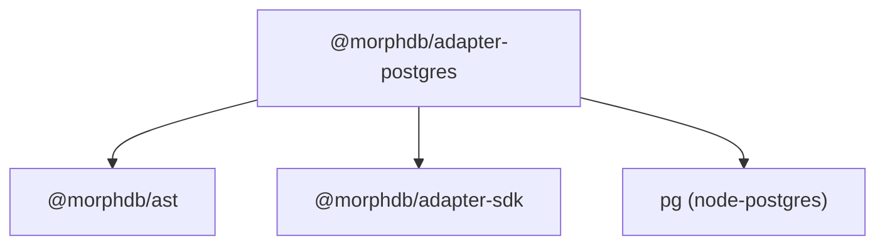

# `@morphdb/adapter-postgres`

> Official PostgreSQL Database Adapter for MorphDB.

---

## 1. Responsibility
The `@morphdb/adapter-postgres` package provides the PostgreSQL storage engine adapter for **MorphDB**. It is responsible for:
- Compiling abstract query AST instances into parameterized PostgreSQL SQL statements via `PostgresCompiler`.
- Managing PostgreSQL connection pools using `pg.Pool`.
- Handling transactional sessions with native SQL isolation levels (`BEGIN`, `COMMIT`, `ROLLBACK`, `SAVEPOINT`).
- Exposing a driver-native escape hatch for raw SQL queries (`adapter.native()`).

---

## 2. Public API

```typescript
export class PostgresAdapter implements DatabaseAdapter {
  readonly name: string;
  readonly capabilities: CapabilitiesSet;
  constructor(config: PoolConfig);
  connect(): Promise<void>;
  disconnect(): Promise<void>;
  execute<T>(ast: SelectQueryNode, session?: TransactionSession): Promise<QueryResult<T>>;
  beginTransaction(options?: TransactionOptions): Promise<TransactionSession>;
  native<T>(rawQuery: unknown): Promise<T>;
}

export class PostgresCompiler implements ASTVisitor<string> {
  static compile(node: SelectQueryNode): CompiledSQLStatement;
}
```

---

## 3. Folder Structure

```
adapters/postgres/
├── package.json
├── tsconfig.json
├── README.md
├── src/
│   ├── index.ts               # Barrel exports
│   ├── postgres-adapter.ts    # PostgresAdapter class
│   └── postgres-compiler.ts   # PostgresCompiler AST visitor
├── tests/
│   └── postgres.test.ts       # Vitest unit & compiler tests
├── benchmarks/
│   └── query.bench.ts         # Query AST compilation benchmarks
└── examples/
    └── index.ts              # Runnable usage example
```

---

## 4. Internal Components
- **`PostgresCompiler`**: Implements `ASTVisitor<string>` to generate parameterized SQL strings (`SELECT ... FROM ... WHERE ... = $1`) with extracted parameter arrays.
- **`PostgresAdapter`**: Manages `pg.Pool` connection lifecycle and transaction execution handles.

---

## 5. Interfaces

```typescript
export interface CompiledSQLStatement {
  readonly sql: string;
  readonly params: ReadonlyArray<unknown>;
}
```

---

## 6. Dependency Graph



---

## 7. Extension Points
- **Postgres Custom Dialects**: Extend `PostgresCompiler` to support PostgreSQL-specific functions (JSONB operators `->>`, full-text search `tsvector`).

---

## 8. Design Patterns Used
- **Visitor Pattern**: Implements `ASTVisitor<string>` for SQL statement lowering.
- **Adapter Pattern**: Wraps `pg.Pool` to satisfy the universal `DatabaseAdapter` port interface.
