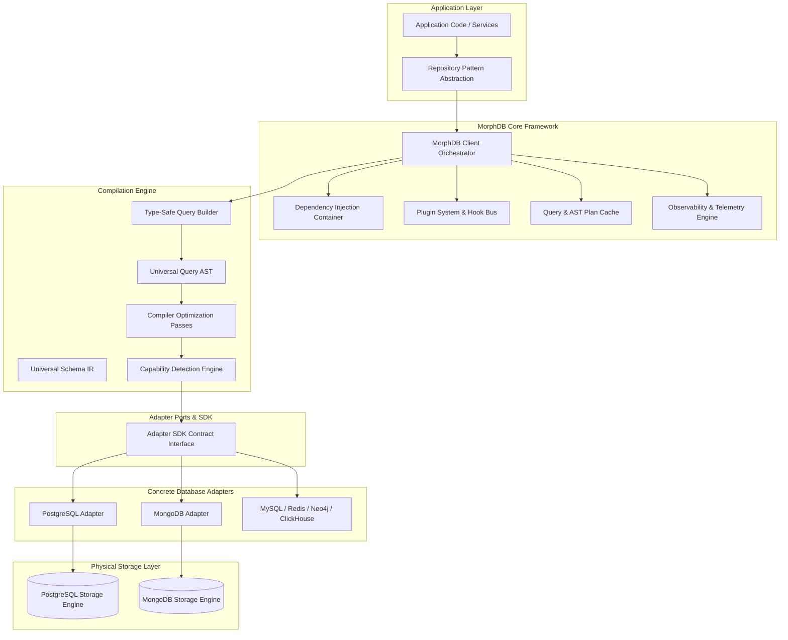
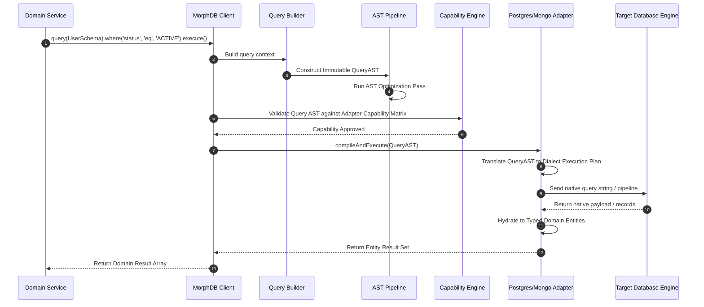

# MorphDB High-Level Design (HLD)

## Overview

The High-Level Design of **MorphDB** establishes a modular monorepo framework built upon **Hexagonal Architecture (Ports and Adapters)**, **Clean Architecture**, and **Compiler Design Principles**. 

MorphDB isolates application domain code from physical database storage mechanisms through an Abstract Syntax Tree (AST) query translation pipeline, a dynamic schema Intermediate Representation (IR), and a dynamic Capability Detection engine.

---

## High-Level Architecture Diagram

---

## Core System Modules

### 1. Engine Client & Core Lifecycle (`@morphdb/core`)
The orchestrator managing database connection pools, plugin lifecycle hooks (`beforeQuery`, `afterQuery`, `onSchemaRegister`), context management (tenancy, tracing), and event dispatching.

### 2. Universal Schema IR (`@morphdb/schema`)
Provides declarative API primitives (`defineSchema`, `field`) to construct an in-memory Intermediate Representation (IR) of entity schemas. Converts schema definitions into dialect-specific DDL (SQL `CREATE TABLE`) or Document Validation schemas (MongoDB `$jsonSchema`).

### 3. Query Compilation Pipeline (`@morphdb/query-builder`, `@morphdb/ast`)
- **Query Builder**: Exposes fluent, type-safe API for constructing CRUD, aggregation, and filtering queries.
- **AST Compiler**: Transforms builder chains into immutable AST nodes (`SelectQueryNode`, `FilterNode`, `JoinNode`).
- **Optimization Passes**: Runs AST transformations (predicate pushdown, index hint injection, query normalization).

### 4. Adapter SDK & Capability Matrix (`@morphdb/adapter-sdk`)
Defines the `DatabaseAdapter` interface contract that all physical adapters must satisfy. It incorporates the **Capability Matrix**, which allows adapters to declare supported features (`TRANSACTIONS_TWO_PHASE`, `JSON_PATH_QUERY`, `FULL_TEXT_SEARCH`, `FOREIGN_KEY_CASCADE`).

### 5. Plugin & Event Engine (`@morphdb/events`, `@morphdb/plugin-system`)
Allows third-party extensions to hook into query processing, schema validation, telemetry collection, or caching strategies without modifying core source code.

---

## Detailed Rationale & Architecture Analysis

### Why Hexagonal Architecture & Compiler AST?
- **Hexagonal Isolation**: Decouples application logic from database drivers (`pg`, `mongodb`), allowing developers to mock database interfaces for unit testing without spinning up actual engines.
- **AST Intermediate Representation**: Decouples query expression from target syntax. Adding support for a new database (e.g., SQLite or Cassandra) requires writing a new compiler pass for `@morphdb/adapter-sdk` without altering `@morphdb/query-builder`.

### Tradeoffs
- **Indirection Latency**: Navigating through Client -> QB -> AST -> Compiler -> Driver incurs a slight microsecond abstraction tax compared to executing raw SQL strings. *Mitigation*: Cached AST compilation and zero-allocation AST node builders.
- **Schema Generalization**: Representing complex engine-specific primitives (e.g., PostgreSQL `tsvector` or MongoDB geospatial `2dsphere` indexes) requires abstracted IR types.

### Alternatives
1. **Direct Driver Wrappers (e.g., TypeORM Driver Pattern)**: Relies on string builder classes per driver. Rejected because string generation lacks validation optimization passes and leads to fragile regex string transformations.
2. **Binary Process Engine (e.g., Prisma Engine)**: Compiles query logic into a binary executable. Rejected due to IPC transport costs and incompatibility with cloud serverless / edge runtime limits (Cloudflare Workers, Vercel Edge).

### Future Scalability
- **Distributed Query Planning**: The AST engine can be extended to perform federated joins across heterogeneous databases (e.g., joining PostgreSQL `users` with MongoDB `activity_logs`).
- **Edge Deployment**: Designed as a pure TypeScript non-native monorepo to run natively in Node.js, Deno, and Bun runtimes.

---

## Subsystem Interaction Sequence Diagram

---

## Best Practices & Common Mistakes

### Best Practices
- **Use Dependency Injection**: Pass the `MorphDBClient` instance down via dependency containers rather than importing global instances.
- **Maintain Modular Adapter Imports**: Import only the required adapters (`@morphdb/adapter-postgres`) to ensure tree-shaking removes unused database dependencies from bundle size.

### Common Mistakes
- **Direct Adapter Instantiation in Domain Code**: Instantiate database adapters at the application bootstrap layer only, never inside domain controllers or HTTP handlers.
