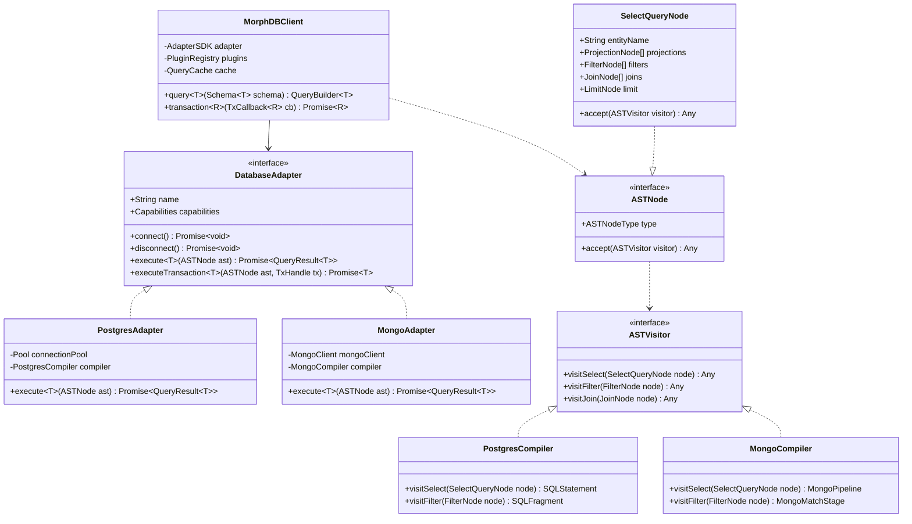

# MorphDB Low-Level Design (LLD)

## Overview

The Low-Level Design (LLD) specifies the concrete class hierarchies, object models, design patterns, type-level interfaces, and execution flow implementations for **MorphDB**.

MorphDB applies proven Object-Oriented and Functional Design Patterns (**Strategy**, **Adapter**, **Bridge**, **Repository**, **Abstract Factory**, and **Visitor Pattern**) to maintain strict static type inference and runtime predictability.

---

## Class & Interface Class Diagram



---

## Key Design Patterns Implementation

### 1. Adapter & Bridge Pattern (Database Ports & Execution Engines)
- **Port Interface**: `DatabaseAdapter` serves as the abstract bridge between the generic client orchestrator and concrete database connection libraries (`pg`, `mongodb`).
- **Isolation**: Domain application code depends exclusively on `DatabaseAdapter` contracts, ensuring zero compile-time dependencies on database native drivers.

### 2. Strategy & Visitor Pattern (AST Compiler Passes)
- **Visitor Pattern**: Query compilation uses `ASTVisitor` interface. `PostgresCompiler` and `MongoCompiler` implement visitor methods for every AST node type.
- **Strategy Pattern**: The client selects the dialect compiler strategy dynamically at runtime based on the attached adapter instance.

### 3. Builder & Fluent API Pattern (Type-Safe Query Builder)
- Generates strongly-typed query AST instances through method chaining (`.where()`, `.join()`, `.limit()`). TypeScript generic parameters infer field names and return shapes at compile time.

---

## Type Inference & Capability Matrix System

### Capability Bitmask Architecture
Adapters advertise supported runtime capabilities via a type-safe `CapabilitySet`:

```typescript
export enum Capability {
  RELATIONAL_JOINS = 'RELATIONAL_JOINS',
  ACID_TRANSACTIONS = 'ACID_TRANSACTIONS',
  NATIVE_JSON_QUERIES = 'NATIVE_JSON_QUERIES',
  FULLTEXT_SEARCH = 'FULLTEXT_SEARCH',
  GEOSPATIAL_SEARCH = 'GEOSPATIAL_SEARCH',
  NESTED_DOCUMENTS = 'NESTED_DOCUMENTS'
}

export type CapabilitiesSet = ReadonlySet<Capability>;
```

### AST Visitor Compiler Interface
```typescript
export interface ASTNode {
  readonly kind: string;
  accept<R>(visitor: ASTVisitor<R>): R;
}

export interface ASTVisitor<R> {
  visitSelectQuery(node: SelectQueryNode): R;
  visitFilterExpression(node: FilterExpressionNode): R;
  visitJoinExpression(node: JoinExpressionNode): R;
  visitSortExpression(node: SortExpressionNode): R;
}
```

---

## Detailed Rationale & Architecture Analysis

### Why Visitor Pattern over Switch Statements?
- **Visitor Pattern**: Guarantees compiler completeness at build time. When a new `ASTNode` is introduced, TypeScript forces all dialect compilers (`PostgresCompiler`, `MongoCompiler`) to implement the corresponding `visit` method, preventing unhandled AST node bugs.

### Tradeoffs
- **Class Boilerplate**: Implementing visitor classes and AST interface contracts requires more boilerplate code than simple JSON objects or procedural switch statements.
- **Deep Call Stacks**: Double dispatch (`node.accept(visitor)`) adds method call stack frames. *Mitigation*: Modern V8 JIT engines inline AST visitor calls cleanly.

### Alternatives
1. **Procedural `switch (node.type)` Statements**: Fast to implement, but prone to silent runtime failures when unhandled AST cases are added without exhaustive type-checking.
2. **Object Mapping Dictionaries**: Fragile when handling complex nested condition trees (`AND`/`OR` groups).

### Future Scalability
- **Custom Dialect Extensions**: External library authors can implement custom `ASTVisitor` passes to support new target databases (e.g., SQLite or DynamoDB) without modifying `@morphdb/core`.
- **AST Middleware**: Allows security plugins to rewrite AST nodes automatically (e.g., appending tenant filter rules to every query AST before compilation).

---

## Advanced Usage & Code Snippet

### Implementing a Dialect Compiler (PostgreSQL Visitor Example)
```typescript
export class PostgresCompiler implements ASTVisitor<string> {
  private paramIndex = 1;
  public readonly params: unknown[] = [];

  public visitSelectQuery(node: SelectQueryNode): string {
    const fields = node.projections.map(p => `"${p.field}"`).join(', ');
    const table = `"${node.tableName}"`;
    const whereClause = node.filter ? ` WHERE ${node.filter.accept(this)}` : '';
    const limitClause = node.limit ? ` LIMIT ${node.limit.value}` : '';
    
    return `SELECT ${fields} FROM ${table}${whereClause}${limitClause};`;
  }

  public visitFilterExpression(node: FilterExpressionNode): string {
    this.params.push(node.value);
    return `"${node.field}" ${node.operator} $${this.paramIndex++}`;
  }

  public visitJoinExpression(node: JoinExpressionNode): string {
    return `INNER JOIN "${node.targetTable}" ON "${node.leftKey}" = "${node.rightKey}"`;
  }

  public visitSortExpression(node: SortExpressionNode): string {
    return `"${node.field}" ${node.direction}`;
  }
}
```

---

## Best Practices & Common Mistakes

### Best Practices
- **Immutable AST Nodes**: Ensure all `ASTNode` instances created by the `QueryBuilder` are strictly frozen (`Object.freeze()`) to prevent side-effect mutations during compiler optimization passes.
- **Parameterized Expressions**: Always extract filter scalar values into parameter arrays within compiler passes to prevent SQL / BSON injection vulnerabilities.

### Common Mistakes
- **Mutating AST state inside visitors**: Visitors must be pure functions generating target query structures without modifying input AST nodes.
