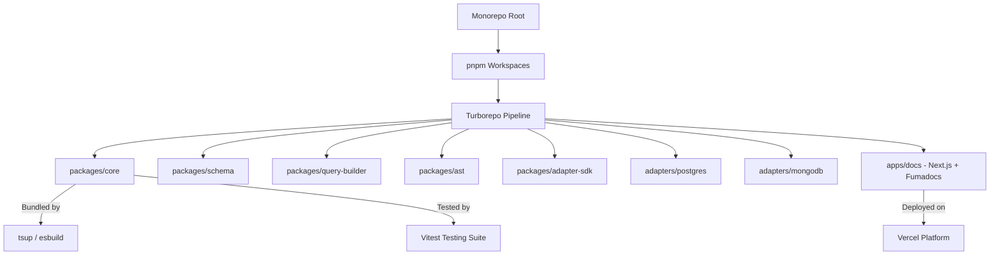

# MorphDB Technology Stack Matrix

## Overview

The technology stack chosen for **MorphDB** reflects modern, enterprise-grade open-source engineering standards. Every tool and library in the stack has been selected based on runtime efficiency, developer experience, type safety, monorepo scalability, and long-term ecosystem stability.

---

## Core Technology Selection Matrix

| Category | Technology | Selected Version | Purpose / Role |
| :--- | :--- | :--- | :--- |
| **Language** | TypeScript | `^5.4.0` | Primary language for type-safety, generics, and AST engine |
| **Runtime** | Node.js | `>=20.0.0 LTS` | Server-side JavaScript execution environment |
| **Package Manager** | pnpm | `^10.0.0` | Monorepo dependency management with strict symlinks |
| **Monorepo Engine** | Turborepo | `^2.0.0` | Build orchestration, remote caching, and task execution pipeline |
| **Package Bundler** | tsup | `^8.0.0` | Fast TypeScript bundler powered by esbuild (ESM & CommonJS) |
| **Testing Engine** | Vitest | `^1.5.0` | Blazing-fast unit and integration testing engine |
| **E2E Testing** | Playwright | `^1.42.0` | End-to-end documentation website & playground testing |
| **Linter** | ESLint | `^9.0.0` | Static analysis with flat configuration system |
| **Formatter** | Prettier | `^3.2.0` | Code formatting consistency across monorepo |
| **Git Hooks** | Husky & lint-staged | `^9.0.0` / `^15.0.0` | Pre-commit git hook enforcement for types & linting |
| **Release Management**| Changesets | `^2.27.0` | Automated semver versioning and release changelog generation |
| **Documentation Site**| Next.js / Fumadocs | `^14.2.0` / `^12.0.0` | Enterprise documentation website framework |
| **Diagraming Engine** | Mermaid.js | `^10.9.0` | Declarative architectural flowcharts & sequence diagrams |

---

## Technical Rationale & Tradeoffs Analysis

### 1. Monorepo Package Manager: `pnpm` vs. `npm` / `yarn`

#### Why?
`pnpm` uses a content-addressable storage structure with hard links and symlinks. This eliminates duplicated node_modules across 15+ sub-packages, speeds up installation times by 3-5x, and enforces strict dependency isolation (preventing phantom dependencies).

#### Tradeoffs
Requires developers to strictly declare peer dependencies across monorepo packages.

#### Alternatives Considered
- **Yarn Workspaces**: Slower resolution, historically prone to hoisting leak issues.
- **npm Workspaces**: Lacks advanced filtering syntax (`pnpm --filter @morphdb/core...`) and strict hoisting isolation.

---

### 2. Monorepo Orchestration: `Turborepo` vs. `Nx` / `Lerna`

#### Why?
`Turborepo` provides zero-config task pipelines (`build`, `test`, `lint`), incremental task caching, and remote build caching support via Vercel. It seamlessly manages dependent package builds in topological order.

#### Tradeoffs
Less plugin code generation functionality compared to Nx.

#### Alternatives Considered
- **Nx**: Highly capable, but introduces heavy abstraction frameworks and code generators that violate our "Zero Magic" design philosophy.
- **Lerna**: Legacy tool now owned by Nx, lacks native Rust build cache performance.

---

### 3. Bundler Engine: `tsup` vs. `tsc` / `rollup`

#### Why?
`tsup` is powered by `esbuild`, delivering compilation speeds up to 100x faster than traditional `tsc`. It generates clean, tree-shakeable dual ESM and CommonJS bundles (`.mjs` and `.cjs`) alongside TypeScript declaration files (`.d.ts`) out of the box.

#### Tradeoffs
Does not perform type-checking during bundle emission. Type-checking is handled in parallel using `tsc --noEmit`.

#### Alternatives Considered
- **tsc (TypeScript Compiler)**: Extremely slow bundler for multi-package monorepos.
- **Webpack**: Heavy overhead for publishing NPM library primitives.

---

### 4. Testing Framework: `Vitest` vs. `Jest`

#### Why?
`Vitest` shares module resolution and transform pipelines directly with ESM, eliminating Babel transformation steps. It supports native TypeScript out of the box and features fast watch modes and multi-threaded worker pools.

#### Tradeoffs
Smaller legacy plugin ecosystem compared to Jest (though compatible with Jest matchers).

#### Alternatives Considered
- **Jest**: Slower startup times, complex ESM configuration setup in TypeScript monorepos.

---

## Architectural Dependency Tree Diagram

---

## Future Scalability & Architecture Compatibility

- **Node.js LTS Forward-Compatibility**: MorphDB targets standard Node.js ES2022 features, ensuring compatibility with upcoming Node.js versions, Bun runtime, and cloud serverless platforms.
- **Multi-Runtime Distribution**: Dual ESM/CommonJS distribution guarantees compatibility with legacy Node.js CommonJS projects as well as modern ESM-only microservices.
