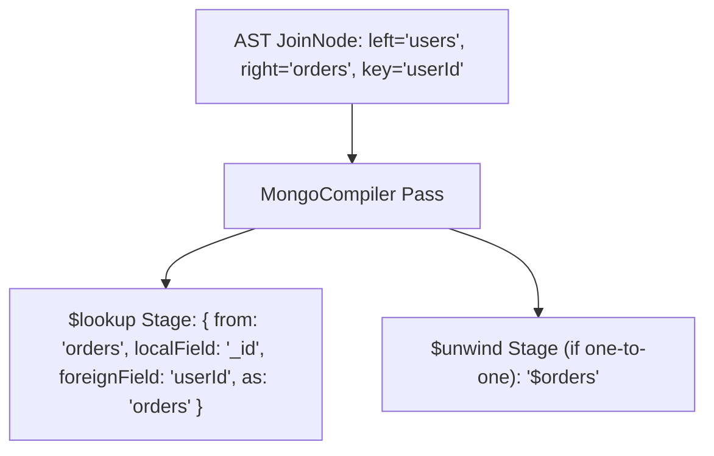

# RFC-002: Cross-Paradigm Dialect Translation Compiler

## Proposal Status
- **State**: APPROVED
- **Author**: Chief Software Architect
- **Target Release**: MorphDB v1.0.0

---

## Abstract

This RFC specifies the AST compilation rules for lowering unified relational query operations (joins, projections, filtering, aggregation, pagination) into native document database aggregation pipelines (specifically MongoDB Aggregation Framework `$lookup`, `$match`, `$project`, `$facet`).

---

## Technical Translation Matrix

### Relational Join -> MongoDB Aggregation Pipeline Lowering

---

## Detailed Rationale & Architecture Analysis

### Why Mongo Aggregation Pipeline over simple `find()` queries?
The MongoDB Aggregation Framework provides feature parity with SQL relational queries (`JOIN` -> `$lookup`, `GROUP BY` -> `$group`, `HAVING` -> `$match`).

### Tradeoffs
MongoDB Aggregation Pipelines carry higher engine processing overhead than simple `find()` queries. *Mitigation*: The `MongoCompiler` generates simple `find()` queries for single-table queries without joins or aggregations.
