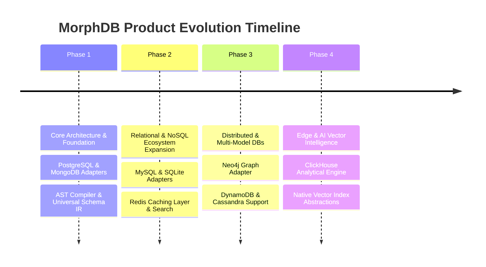

# MorphDB Engineering Product Roadmap

## Overview

The engineering roadmap for **MorphDB** charts the multi-year vision to build the world's leading Universal Data Abstraction Layer. Development is divided into 4 sequential phases.

---

## Strategic Product Phases

---

## Detailed Phase Breakdown

### Phase 1: Foundation & Dual Engine Core (Current)
- Establish monorepo structure with pnpm, Turborepo, tsup, Vitest, Fumadocs.
- Deliver `@morphdb/core`, `@morphdb/schema`, `@morphdb/query-builder`, `@morphdb/ast`, `@morphdb/adapter-sdk`.
- Implement official **PostgreSQL** (`@morphdb/adapter-postgres`) and **MongoDB** (`@morphdb/adapter-mongodb`) adapters.
- 100% Adapter Contract Test suite passing.

### Phase 2: Relational & Key-Value Expansion
- Support **MySQL** (`@morphdb/adapter-mysql`) and embedded **SQLite** (`@morphdb/adapter-sqlite`).
- Release `@morphdb/caching` with **Redis** adapter.
- Launch `@morphdb/migrations` interactive CLI tool.

### Phase 3: Graph & Distributed Data
- Introduce **Neo4j** (`@morphdb/adapter-neo4j`) graph database adapter translating relational join ASTs to Cypher queries.
- Support cloud distributed stores: **Amazon DynamoDB** and **Apache Cassandra**.

### Phase 4: Analytical OLAP & Vector AI
- Implement **ClickHouse** and **DuckDB** analytical adapters.
- Integrated vector embeddings search support (`field.vector()`) targeting pgvector and Qdrant.
