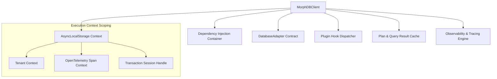

# `@morphdb/core` Technical Specification

## Overview

The `@morphdb/core` package serves as the primary entry point and orchestrator for the **MorphDB** ecosystem. It coordinates connection initialization, client lifecycle management, dependency injection, execution context scoping, and plugin hook dispatching.

---

## Architecture & Component Breakdown



---

## Core Specification Specifications

### 1. `MorphDBClient` Configuration Interface
```typescript
export interface MorphDBConfig {
  adapter: DatabaseAdapter;
  plugins?: ReadonlyArray<MorphDBPlugin>;
  cache?: QueryCacheProvider;
  telemetry?: TelemetryConfig;
  logger?: LoggerInstance;
}

export class MorphDBClient {
  constructor(config: MorphDBConfig);
  public connect(): Promise<void>;
  public disconnect(): Promise<void>;
  public query<T>(schema: SchemaIR<T>): QueryBuilder<T>;
  public transaction<R>(fn: (txClient: MorphDBClient) => Promise<R>): Promise<R>;
}
```

### 2. AsyncLocalStorage Context Management
MorphDB tracks query execution contexts (e.g. multi-tenant identifiers or active database transaction handles) across asynchronous call stacks using Node.js `AsyncLocalStorage`:

```typescript
export interface ExecutionContext {
  tenantId?: string;
  transactionHandle?: TransactionSession;
  traceId?: string;
}

export class ContextManager {
  private static storage = new AsyncLocalStorage<ExecutionContext>();

  public static run<R>(ctx: ExecutionContext, fn: () => Promise<R>): Promise<R> {
    return this.storage.run(ctx, fn);
  }

  public static get(): ExecutionContext | undefined {
    return this.storage.getStore();
  }
}
```

---

## Detailed Rationale & Architecture Analysis

### Why `AsyncLocalStorage` for Transaction & Tenant Scoping?
- **Implicit Context Propagation**: Eliminates the need to explicitly pass transaction objects or tenant ID parameters down through deep application repository layers.

### Tradeoffs
- Microsecond context lookup overhead in V8 engine. *Mitigation*: Negligible compared to network I/O to physical database.

### Alternatives
- **Explicit Parameter Passing**: Requiring every domain method to take a `tx: Transaction` argument. Rejected due to API verbosity and leakage of data-layer concerns into business logic.

---

## Code Examples & Usage

```typescript
import { MorphDBClient } from '@morphdb/core';
import { PostgresAdapter } from '@morphdb/adapter-postgres';

const client = new MorphDBClient({
  adapter: new PostgresAdapter({ connectionString: process.env.DATABASE_URL }),
});

await client.connect();

// Managed Transaction Scope
await client.transaction(async (tx) => {
  const user = await tx.query(UserSchema).create({ name: 'Alice' });
  await tx.query(AuditLogSchema).create({ action: 'USER_CREATED', userId: user.id });
});
```

---

## Best Practices & Common Mistakes

### Best Practices
- **Always Call `disconnect()` on Shutdown**: Ensure application graceful shutdown hooks invoke `client.disconnect()` to safely close underlying connection pools.

### Common Mistakes
- **Creating Multiple `MorphDBClient` Instances per Request**: Instantiate one client instance per application lifecycle, using context scoping for request-level multi-tenancy.
