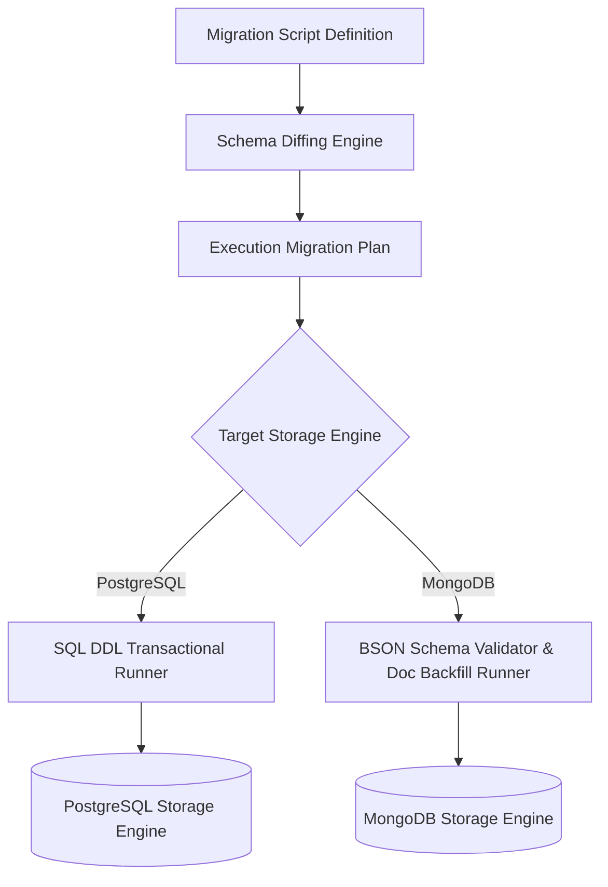

# `@morphdb/migrations` Technical Specification

## Overview

The `@morphdb/migrations` package handles multi-database schema evolution for **MorphDB**. It bridges relational database DDL migrations (`ALTER TABLE`, column additions, index creation) and document database schema evolution (versioning documents, backfilling schema defaults, document validation rules).

---

## Migration Engine Architecture



---

## Migration Plan Specification

```typescript
export interface MigrationStep {
  readonly id: string;
  readonly up: (context: MigrationContext) => Promise<void>;
  readonly down: (context: MigrationContext) => Promise<void>;
}

export interface MigrationContext {
  readonly adapter: DatabaseAdapter;
  readonly schemaDiff: SchemaDiffResult;
  readonly logger: LoggerInstance;
}
```

---

## Detailed Rationale & Architecture Analysis

### Why Universal Schema Evolution Engine?
- Relational databases enforce strict DDL up front, whereas NoSQL document stores evolve through document schema version flags (`_v: 2`). `@morphdb/migrations` encapsulates both techniques behind a single execution CLI.

### Tradeoffs
- Multi-step document migration backfills on large MongoDB collections require background batch processing to avoid collection lock spikes.

---

## Code Examples

```typescript
import { defineMigration } from '@morphdb/migrations';

export default defineMigration({
  id: '20260722_add_user_status',
  async up({ adapter }) {
    await adapter.addColumn('users', {
      name: 'status',
      type: 'string',
      defaultValue: 'ACTIVE',
    });
  },
  async down({ adapter }) {
    await adapter.dropColumn('users', 'status');
  },
});
```

---

## Best Practices & Common Mistakes

### Best Practices
- **Test Migrations against Shadow Databases**: Always run `morphdb migrate up --dry-run` against an ephemeral Shadow Database container in CI before deploying to production.

### Common Mistakes
- **Non-Reversible Migrations**: Writing destructive `up` migrations without writing corresponding fallback recovery logic in `down`.
