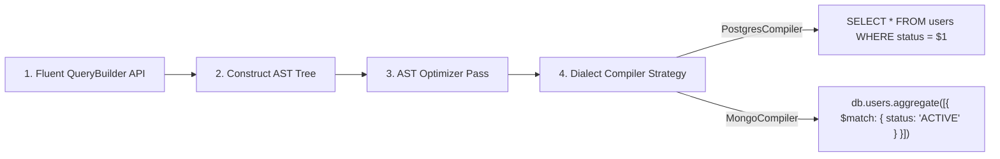

# `@morphdb/query-builder` & `@morphdb/ast` Technical Specification

## Overview

The `@morphdb/query-builder` and `@morphdb/ast` packages provide the query compilation engine for **MorphDB**. Query creation proceeds through a 4-stage pipeline: **Fluent API Assembly**, **AST Construction**, **AST Transformation & Optimization Passes**, and **Dialect Translation Compilation**.

---

## Query Compilation Pipeline Diagram



---

## Technical Specifications

### 1. Abstract Syntax Tree Node Structure (`@morphdb/ast`)

```typescript
export type ASTNodeType = 
  | 'SELECT_QUERY' 
  | 'FILTER_EXPRESSION' 
  | 'JOIN_EXPRESSION' 
  | 'SORT_EXPRESSION'
  | 'PAGINATION';

export interface BaseASTNode {
  readonly kind: ASTNodeType;
}

export class FilterExpressionNode implements BaseASTNode {
  public readonly kind = 'FILTER_EXPRESSION';
  constructor(
    public readonly field: string,
    public readonly operator: 'eq' | 'neq' | 'gt' | 'gte' | 'lt' | 'lte' | 'in' | 'endsWith',
    public readonly value: unknown
  ) {}
}

export class SelectQueryNode implements BaseASTNode {
  public readonly kind = 'SELECT_QUERY';
  constructor(
    public readonly entityName: string,
    public readonly projections: ReadonlyArray<string>,
    public readonly filters: ReadonlyArray<FilterExpressionNode>,
    public readonly joins: ReadonlyArray<JoinExpressionNode>,
    public readonly limit?: number,
    public readonly offset?: number
  ) {}
}
```

---

## Detailed Rationale & Architecture Analysis

### Why AST Compilation over String Concatenation?
1. **Security against Injection**: AST Nodes preserve parameter objects separately from execution structures, rendering SQL injection and BSON injection impossible by construction.
2. **Cross-Paradigm Translation**: AST Nodes express query intent independently of storage paradigm. An AST `JoinExpressionNode` can be lowered into an SQL `INNER JOIN` or a MongoDB `$lookup` pipeline stage.
3. **Compiler Passes**: Allows security plugins to rewrite AST trees (e.g. automatically injecting multi-tenant `tenant_id` filters into every sub-clause).

### Tradeoffs
- Higher memory allocation than raw string concat. *Mitigation*: Node object reuse and LRU compilation result caching.

---

## Code Examples & Usage

### Constructing Query AST
```typescript
import { QueryBuilder } from '@morphdb/query-builder';
import { UserSchema } from './schemas';

const qb = new QueryBuilder(UserSchema)
  .where('status', 'eq', 'ACTIVE')
  .orderBy('createdAt', 'DESC')
  .limit(20);

// Generates immutable SelectQueryNode AST
const astNode = qb.toAST();
```

---

## Best Practices & Common Mistakes

### Best Practices
- **Cache Compiled Execution Plans**: Reuse compiled dialect query strings for parameterized queries to eliminate compilation overhead on hot execution paths.

### Common Mistakes
- **Direct String Injection in Filters**: Never bypass the query builder to inject raw SQL fragments into `.where()` calls.
