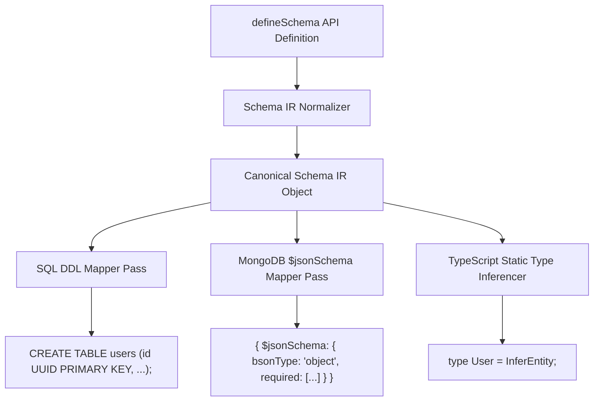

# `@morphdb/schema` Technical Specification

## Overview

The `@morphdb/schema` package defines the **Universal Schema Intermediate Representation (IR)** for **MorphDB**. It translates declarative TypeScript schema definitions into an abstract IR capable of mapping to Relational DDL (PostgreSQL `CREATE TABLE`, foreign key constraints) and Document Validation schemas (MongoDB `$jsonSchema`).

---

## Schema IR Architecture & Type System



---

## Technical Specifications

### 1. Primitive Field Builder API
```typescript
export interface FieldDefinition<T> {
  readonly dataType: string;
  readonly isNullable: boolean;
  readonly isPrimaryKey: boolean;
  readonly isUnique: boolean;
  readonly defaultValue?: unknown;
  readonly referencesTarget?: string;
}

export const field = {
  uuid: () => new FieldBuilder<string>('uuid'),
  string: () => new FieldBuilder<string>('string'),
  int: () => new FieldBuilder<number>('integer'),
  dateTime: () => new FieldBuilder<Date>('datetime'),
  json: () => new FieldBuilder<Record<string, unknown>>('json'),
};
```

### 2. Polyglot Field Mapping Matrix

| Canonical Primitive IR | PostgreSQL DDL Representation | MongoDB Document BSON Representation |
| :--- | :--- | :--- |
| `field.uuid()` | `UUID PRIMARY KEY DEFAULT gen_random_uuid()` | `ObjectId` or `string` |
| `field.string()` | `VARCHAR(255)` / `TEXT` | `string` |
| `field.int()` | `INTEGER` / `BIGINT` | `int` / `long` |
| `field.dateTime()` | `TIMESTAMPTZ` | `date` |
| `field.json()` | `JSONB` | `object` / nested document |

---

## Detailed Rationale & Architecture Analysis

### Why Universal Schema IR?
- **Schema Single-Source-Of-Truth**: Developers specify entity structures once in TypeScript. MorphDB generates database DDL, document validation schemas, and runtime entity type definitions from a single declaration.

### Tradeoffs
- Primitive IR types must generalize across SQL strict types and BSON flexible document types.

### Alternatives
- **Dual Schema Definitions (SQL Schema + Mongo Schema)**: Rejected due to maintenance friction and risk of schema divergence across microservices.

---

## Code Examples & Usage

```typescript
import { defineSchema, field, InferEntity } from '@morphdb/schema';

export const ProductSchema = defineSchema('products', {
  id: field.uuid().primaryKey(),
  sku: field.string().unique(),
  priceInCents: field.int(),
  tags: field.json().optional(),
  createdAt: field.dateTime().defaultToNow(),
});

// Infer TypeScript compile-time shape automatically
export type Product = InferEntity<typeof ProductSchema>;
```

---

## Best Practices & Common Mistakes

### Best Practices
- **Export Schema Definitions alongside Entity Types**: Always export the static type `InferEntity<typeof Schema>` alongside the runtime `defineSchema` definition.

### Common Mistakes
- **Using Native SQL Data Types in `field`**: Never use native data type strings like `VARCHAR(100)` in core schema definitions. Use portable primitives (`field.string()`).
