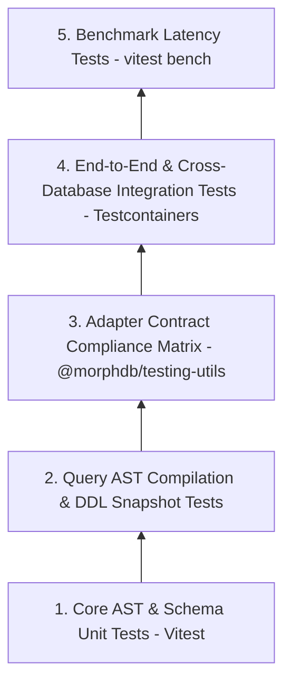

# MorphDB Testing Standards & Test Pyramid

## Overview

The testing strategy for **MorphDB** ensures production resilience through a multi-tiered test pyramid comprising **Unit Tests**, **Adapter Contract Tests**, **Integration Tests**, **Snapshot Tests**, and **Benchmark Performance Gates**.

---

## The 5-Tier Testing Matrix



| Tier | Type | Target Scope | Execution Platform | Target SLAs |
| :--- | :--- | :--- | :--- | :--- |
| **Tier 1** | Unit Tests | `@morphdb/core`, `@morphdb/ast`, `@morphdb/schema` | Vitest (In-Memory) | 100% Code Coverage, < 2s execution |
| **Tier 2** | Snapshot Tests | Query AST -> SQL / BSON Compiler Outputs | Vitest Snapshots | Exact AST transform verification |
| **Tier 3** | Contract Tests | PostgreSQL & MongoDB Adapter Compliance | `@morphdb/testing-utils` | 100% API Parity across database drivers |
| **Tier 4** | Integration Tests | Multi-database transactions, real DDL DML | Vitest + Testcontainers | Docker-isolated real DB execution |
| **Tier 5** | Benchmarks | AST Build Speed & Compilation Throughput | Vitest Bench / Mitata | Latency overhead < 5% vs raw driver |

---

## Adapter Contract Testing Harness

Every official adapter (`@morphdb/adapter-postgres`, `@morphdb/adapter-mongodb`) must pass the universal **Adapter Contract Test Harness**:

```typescript
import { runAdapterContractTests } from '@morphdb/testing-utils';
import { PostgresAdapter } from '@morphdb/adapter-postgres';

// Runs identical test assertions against PostgreSQL container
runAdapterContractTests({
  name: 'PostgreSQL Adapter Suite',
  createAdapter: async () => new PostgresAdapter({ connectionString: process.env.PG_URL }),
});
```

---

## Detailed Rationale & Architecture Analysis

### Why Universal Contract Tests?
- **Behavioral Uniformity**: Ensures that querying `.where('status', 'eq', 'ACTIVE')` returns identical hydrated domain object structures regardless of whether PostgreSQL or MongoDB is acting as the storage engine.

### Tradeoffs
- **Container Spin-Up Time**: Integration tests running against real Docker containers via `Testcontainers` require 15-30 seconds during CI runs. *Mitigation*: Run unit/snapshot suites first, and isolate container suites to parallel CI workers.

### Alternatives
- **In-Memory SQL Mocks (e.g. `sqlite3` or `alasql`)**: Rejected because mock engines fail to replicate target engine behavior (such as PostgreSQL JSONB operators or MongoDB Aggregation Pipeline `$facet` semantics).

---

## Best Practices & Common Mistakes

### Best Practices
- **Use Testcontainers for Real Databases**: Never mock database drivers in integration test suites. Spin up lightweight PostgreSQL and MongoDB instances in Docker.
- **Snapshot AST Transformations**: Maintain explicit AST compiler output snapshots to catch unintended regressions in generated SQL or BSON queries.

### Common Mistakes
- **Hardcoding Ports or Credentials**: Never hardcode database ports (`5432`, `27017`) in test files. Always read dynamic host ports allocated by Testcontainers.
