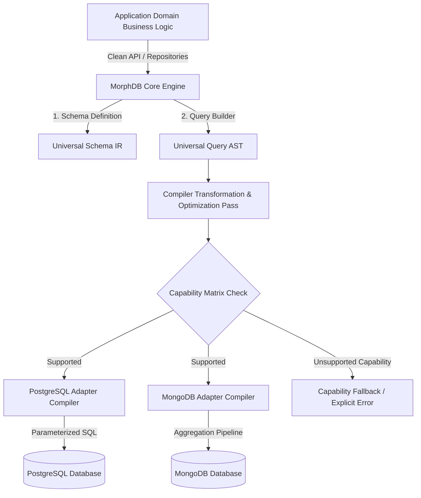

# MorphDB Vision & Product Strategy

## Overview

**MorphDB** ("Write Once. Connect Everywhere.") is a Universal Data Abstraction Layer (UDAL) designed for modern TypeScript applications. Unlike traditional Object-Relational Mappers (ORMs) or Object-Document Mappers (ODMs) that bind an application tightly to a specific database paradigm (Relational vs. Document vs. Key-Value vs. Graph), MorphDB provides a unified intermediate representation (IR) for schemas, queries, migrations, and transactions.

The core mission of MorphDB is to make database engines pluggable infrastructure components—allowing applications to switch from PostgreSQL to MongoDB (or scale horizontally to Redis, DynamoDB, Neo4j, or ClickHouse) with minimal to zero modifications in core domain logic.

---

## Core Vision & Philosophy

### 1. Database Decoupling as First-Class Architecture
Modern enterprise applications often suffer from database vendor lock-in. Switching from PostgreSQL to MongoDB or SQLite requires rewriting database schemas, query builders, repository classes, and transaction handlers. MorphDB decouples business logic from database execution engines using **Clean Architecture** and **Hexagonal Architecture (Ports and Adapters)**.

### 2. AST-Driven Compiler Architecture
Rather than concatenating SQL strings or constructing raw MongoDB pipeline objects directly, MorphDB converts developer queries into a strongly-typed Abstract Syntax Tree (AST). Target adapters act as compilers that lower the AST into native dialect queries (e.g., SQL parameterized queries or MongoDB Aggregation Pipelines).

### 3. Progressive Capability Degradation & Detection
No two databases possess identical capabilities. PostgreSQL supports ACID multi-table joins, while MongoDB provides flexible nested document structures. MorphDB features a dynamic **Capabilities Matrix** that detects database capabilities at runtime, allowing graceful degradation or explicit opt-in native overrides without breaking unified contracts.

---

## Architectural Diagram



---

## Competitive Analysis

| Dimension | Prisma | Drizzle ORM | TypeORM | MorphDB |
| :--- | :--- | :--- | :--- | :--- |
| **Primary Model** | Relational / Document Engine | Relational (SQL-First) | Relational (Active Record / Data Mapper) | **Universal Heterogeneous Abstraction** |
| **Engine Translation** | Rust Binary Engine (IPC overhead) | Dialect-specific SQL generators | SQL Query Builders | **AST Compiler Pass in Pure TypeScript** |
| **Polyglot Schema** | Single engine per schema file | Separate drivers per DB | Multi-driver decorators | **Universal Canonical Schema IR** |
| **Cross-Paradigm Switching** | SQL only (Mongo support limited) | SQL databases only | SQL databases only | **Seamless PostgreSQL <-> MongoDB Switching** |
| **Plugin Architecture** | Generator plugins only | Middleware wrappers | Custom drivers | **Hexagonal Core & Lifecycle Hooks** |

---

## Detailed Rationale & Architecture Analysis

### Why?
1. **Infrastructure Agnosticism**: Cloud migration costs are dominated by data layer refactoring. MorphDB minimizes migration friction to simple configuration updates.
2. **Polyglot Persistence Readiness**: Multi-tenant or microservice architectures frequently require relational storage for transactional user data and document databases for high-throughput activity logs. MorphDB allows teams to share schema definitions, validation logic, and query patterns across both workloads.
3. **Type Safety & Zero Magic**: TypeScript's type system is leveraged to infer query return types directly from entity definitions without relying on code generation binaries or dynamic proxy magic.

### Tradeoffs
- **Lowest Common Denominator Risk**: Abstracting across SQL and NoSQL risks obscuring database-specific optimizations (e.g., PostgreSQL custom CTEs or MongoDB `$facet` pipelines). *Mitigation*: MorphDB provides explicit escaping mechanisms (`adapter.native(...)`) when peak engine optimization is required.
- **AST Compilation Overhead**: Constructing and traversing AST nodes adds microsecond latency compared to direct string concatenation. *Mitigation*: Compiled query ASTs are cached using LRU execution caches.

### Alternatives Considered
1. **Direct SQL Generation Strings**: Rejected due to vulnerability to SQL injection bugs, inability to support document structures, and lack of compiler optimization passes.
2. **Prisma Engine IPC Model**: Rejected due to Rust binary inter-process communication overhead, heavy cold-start footprint in serverless environments, and opaque engine internals.

### Future Scalability
MorphDB's compiler pipeline is designed to support:
- **Graph Adapters (Neo4j Cypher)**: Translating relational joins into Cypher path traversals.
- **Key-Value Adapters (Redis)**: Auto-indexing secondary keys into hash sets.
- **OLAP Engines (ClickHouse / DuckDB)**: Vectorizing analytics AST queries for columnar execution.

---

## Code Examples

### Defining a Universal Entity
```typescript
import { defineSchema, field } from '@morphdb/schema';

export const UserSchema = defineSchema('users', {
  id: field.uuid().primaryKey(),
  email: field.string().unique(),
  name: field.string(),
  metadata: field.json().optional(),
  createdAt: field.dateTime().defaultToNow(),
});
```

### Executing Cross-Database Query
```typescript
import { MorphDBClient } from '@morphdb/core';

// Execution context works identically whether configured with PostgresAdapter or MongoAdapter
const client = new MorphDBClient({ adapter: activeAdapter });

const users = await client.query(UserSchema)
  .where('email', 'endsWith', '@enterprise.com')
  .orderBy('createdAt', 'DESC')
  .limit(10)
  .execute();
```

---

## Best Practices & Common Mistakes

### Best Practices
- **Define schemas using canonical primitives**: Rely on generic types (`field.string()`, `field.dateTime()`) rather than engine-specific types (`VARCHAR(255)`, `BSON Date`) to preserve cross-database portability.
- **Inspect Capability Matrix in CI**: Run integration test suites against both PostgreSQL and MongoDB test containers to verify that query logic executes cleanly across target dialects.

### Common Mistakes
- **Relying on implicit ordering**: Relational databases return records non-deterministically without `ORDER BY`; MongoDB sorts by `_id` by default. Always specify explicit `orderBy()` calls when deterministic result pagination is required.
- **Leaking native query primitives into application logic**: Avoid embedding raw SQL fragments in application controllers; isolate engine overrides behind custom repository methods.
