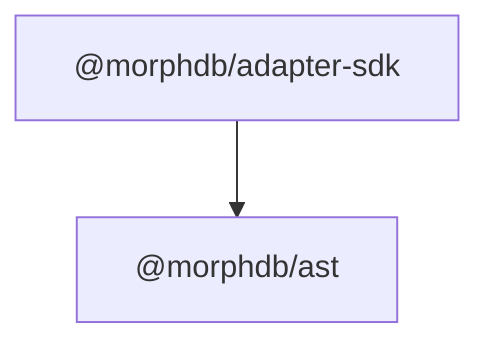

# `@morphdb/adapter-sdk`

> Database Adapter Interface Contracts, Capability Matrix, and Transaction Abstractions.

---

## 1. Responsibility
The `@morphdb/adapter-sdk` package establishes the Port contracts for physical storage engines in **MorphDB**. It is responsible for:
- Defining the `DatabaseAdapter` port interface.
- Exposing the dynamic `CapabilitiesSet` matrix assertion engine.
- Managing transactional session handles (`TransactionSession`) and sub-transaction savepoints (`SavepointManager`).

---

## 2. Public API

```typescript
export interface DatabaseAdapter {
  readonly name: string;
  readonly capabilities: CapabilitiesSet;
  connect(): Promise<void>;
  disconnect(): Promise<void>;
  execute<T>(ast: SelectQueryNode, session?: TransactionSession): Promise<QueryResult<T>>;
  beginTransaction(options?: TransactionOptions): Promise<TransactionSession>;
  native<T>(rawQuery: unknown): Promise<T>;
}

export class CapabilitiesSet {
  constructor(capabilities: Iterable<Capability>);
  has(capability: Capability): boolean;
  assertSupported(capability: Capability, actionName: string): void;
  toArray(): ReadonlyArray<Capability>;
}
```

---

## 3. Folder Structure

```
packages/adapter-sdk/
├── package.json
├── tsconfig.json
├── README.md
├── src/
│   ├── index.ts           # Barrel exports
│   ├── adapter.ts         # DatabaseAdapter & QueryResult contracts
│   ├── capabilities.ts    # Capability enum & CapabilitiesSet matrix
│   ├── transaction.ts     # TransactionSession & TransactionOptions
│   └── savepoint.ts       # SavepointManager & SavepointHandle
└── tests/
    └── adapter-sdk.test.ts # Vitest unit tests
```

---

## 4. Internal Components
- **`CapabilitiesSet`**: Validates whether requested query operations are supported by the attached database adapter before query compilation.
- **`SavepointManager`**: Tracks sub-transaction savepoint names to emulate nested transactions on engines lacking native savepoints.

---

## 5. Interfaces

```typescript
export enum Capability {
  ACID_TRANSACTIONS = 'ACID_TRANSACTIONS',
  RELATIONAL_JOINS = 'RELATIONAL_JOINS',
  NESTED_DOCUMENTS = 'NESTED_DOCUMENTS',
  JSON_PATH_SEARCH = 'JSON_PATH_SEARCH',
  SAVEPOINTS = 'SAVEPOINTS',
  RETURNING_CLAUSE = 'RETURNING_CLAUSE',
  FULLTEXT_SEARCH = 'FULLTEXT_SEARCH',
}

export interface QueryResult<T = unknown> {
  readonly rows: ReadonlyArray<T>;
  readonly affectedRows?: number;
  readonly executionTimeMs: number;
}
```

---

## 6. Dependency Graph



---

## 7. Extension Points
- **Third-Party Adapters**: Implement `DatabaseAdapter` to connect MorphDB to custom databases (e.g. SQLite, Neo4j, Redis, Cassandra).

---

## 8. Design Patterns Used
- **Adapter / Port Pattern**: Decouples physical driver libraries from MorphDB core.
- **Bridge Pattern**: Separates abstract query operations from concrete storage implementations.
- **Strategy Pattern**: Adapters serve as pluggable strategies attached to `MorphDBClient`.
