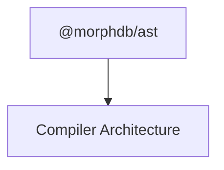

# `@morphdb/ast`

> Abstract Syntax Tree (AST) Nodes, Visitor Compiler Interfaces, and Structural Hash Normalizer.

---

## 1. Responsibility
The `@morphdb/ast` package contains the immutable intermediate syntax representations for **MorphDB**. It is responsible for:
- Defining compiler AST nodes (`SelectQueryNode`, `FilterExpressionNode`, `JoinNode`, `SortNode`, `PaginationNode`).
- Providing the `ASTVisitor<R>` interface contract for target dialect compilers.
- Normalizing dynamic parameter scalars into structural AST hashes for LRU compilation plan caching (`ASTNormalizer`).

---

## 2. Public API

```typescript
export interface ASTVisitor<R> {
  visitSelectQuery(node: SelectQueryNode): R;
  visitFilterExpression(node: FilterExpressionNode): R;
  visitJoinExpression(node: JoinNode): R;
  visitSortExpression(node: SortNode): R;
  visitPagination(node: PaginationNode): R;
}

export interface ASTNode {
  readonly kind: ASTNodeKind;
  accept<R>(visitor: ASTVisitor<R>): R;
}

export class ASTNormalizer {
  static normalize(node: SelectQueryNode): NormalizedASTResult;
}
```

---

## 3. Folder Structure

```
packages/ast/
├── package.json
├── tsconfig.json
├── README.md
├── src/
│   ├── index.ts               # Barrel exports
│   ├── ast-node.ts            # Base ASTNode & ASTVisitor definitions
│   ├── select-query-node.ts   # Root SelectQueryNode
│   ├── filter-node.ts         # FilterExpressionNode
│   ├── join-node.ts           # JoinNode
│   ├── sort-node.ts           # SortNode
│   ├── pagination-node.ts     # PaginationNode
│   └── normalizer.ts          # ASTNormalizer structural hash engine
└── tests/
    └── ast.test.ts            # Vitest unit tests
```

---

## 4. Internal Components
- **`SelectQueryNode`**: Root AST node aggregating projections, filter expressions, joins, sort nodes, and pagination bounds.
- **`ASTNormalizer`**: Extracts dynamic filter values into parameter arrays while computing a structural hash signature for execution plan caching.

---

## 5. Interfaces

```typescript
export enum ASTNodeKind {
  SELECT_QUERY = 'SELECT_QUERY',
  FILTER_EXPRESSION = 'FILTER_EXPRESSION',
  JOIN_EXPRESSION = 'JOIN_EXPRESSION',
  SORT_EXPRESSION = 'SORT_EXPRESSION',
  PAGINATION = 'PAGINATION',
}

export interface NormalizedASTResult {
  readonly structuralHash: string;
  readonly extractedParameters: ReadonlyArray<unknown>;
}
```

---

## 6. Dependency Graph



---

## 7. Extension Points
- **New AST Node Kinds**: Add `InsertNode`, `UpdateNode`, `DeleteNode`, `GroupByNode` for DML extensions.
- **Custom Visitor Compiler Passes**: External authors implement `ASTVisitor<R>` to compile query ASTs to Cypher, SQLite, or Redis.

---

## 8. Design Patterns Used
- **Visitor Pattern**: Double dispatch compiler traversal (`node.accept(visitor)`).
- **Composite Pattern**: Tree structures of nested AST nodes.
- **Immutable Object Pattern**: All AST nodes are frozen (`Object.freeze()`).
