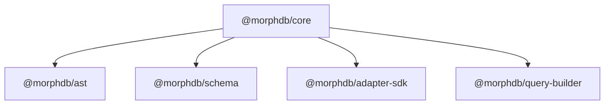

# `@morphdb/core`

> Engine Orchestrator, Execution Scoping, Identity Map, and Unit of Work for MorphDB.

---

## 1. Responsibility
The `@morphdb/core` package acts as the central client orchestrator and execution context manager for **MorphDB**. It is responsible for:
- Initializing database connection lifecycles via attached `DatabaseAdapter` instances.
- Tracking request execution context (multi-tenant IDs, transaction handles, telemetry span context) using Node.js `AsyncLocalStorage`.
- Managing transactional entity reference equality using the **Identity Map** and **Unit of Work** patterns.
- Dispatching query operations to the AST builder and adapter layers.

---

## 2. Public API

```typescript
export class MorphDBClient {
  constructor(config: MorphDBConfig);
  connect(): Promise<void>;
  disconnect(): Promise<void>;
  query<T>(schema: SchemaIR<T>): QueryBuilder<T>;
  executeQuery<T>(builder: QueryBuilder<any>): Promise<QueryResult<T>>;
  transaction<R>(fn: (txClient: MorphDBClient) => Promise<R>, options?: TransactionOptions): Promise<R>;
}

export class ContextManager {
  static run<R>(ctx: ExecutionContext, fn: () => Promise<R>): Promise<R>;
  static get(): ExecutionContext | undefined;
}

export class IdentityMap {
  get<T>(entityName: string, primaryKey: string | number): T | undefined;
  register<T>(entityName: string, primaryKey: string | number, instance: T): T;
  clear(): void;
}

export class UnitOfWork {
  registerClean<T>(entityName: string, primaryKey: string | number, entity: T): void;
  registerDirty<T>(entityName: string, primaryKey: string | number, entity: T): void;
  commit(): Promise<void>;
}
```

---

## 3. Folder Structure

```
packages/core/
├── package.json
├── tsconfig.json
├── README.md
├── src/
│   ├── index.ts               # Barrel exports
│   ├── client.ts              # MorphDBClient orchestrator
│   ├── context.ts             # AsyncLocalStorage ContextManager
│   ├── identity-map.ts        # Transactional Identity Map
│   ├── unit-of-work.ts        # Unit of Work pattern
│   └── errors.ts             # MorphDBError base class & exceptions
├── tests/
│   └── core.test.ts          # Vitest test suite
└── examples/
    └── index.ts              # Runnable usage example
```

---

## 4. Internal Components
- **`MorphDBClient`**: Primary entry point connecting schema definitions, query builders, and physical database adapters.
- **`ContextManager`**: Uses `AsyncLocalStorage<ExecutionContext>` to bind active transaction handles implicitly to asynchronous stack traces.
- **`IdentityMap`**: Maintains a key-value store (`${entityName}:${primaryKey}`) of hydrated JavaScript objects within transaction boundaries.
- **`UnitOfWork`**: Tracks clean, dirty, and new domain entities during transactional operations to flush updates efficiently.

---

## 5. Interfaces

```typescript
export interface MorphDBConfig {
  readonly adapter: DatabaseAdapter;
}

export interface ExecutionContext {
  readonly tenantId?: string;
  readonly session?: TransactionSession;
  readonly identityMap: IdentityMap;
  readonly unitOfWork?: UnitOfWork;
  readonly traceId?: string;
}
```

---

## 6. Dependency Graph



---

## 7. Extension Points
- **Plugin Hooks**: Hook into client execution points (`beforeQuery`, `afterQuery`, `onTransactionCommit`).
- **Custom Context Stores**: Extend `ExecutionContext` with custom tenant or authorization state.

---

## 8. Design Patterns Used
- **Orchestrator Pattern**: `MorphDBClient` coordinates schema IR, query building, and adapter execution.
- **Identity Map Pattern**: Ensures object reference equality across transactional queries.
- **Unit of Work Pattern**: Tracks entity changes within transaction boundaries.
- **Dependency Injection**: Adapters and plugins are injected into the client upon initialization.
