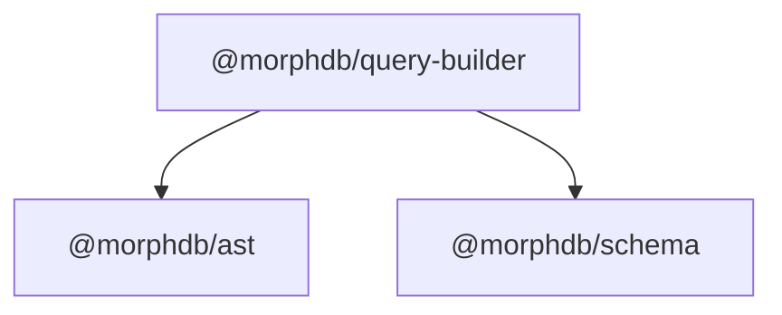

# `@morphdb/query-builder`

> Type-Safe Fluent Query Builder and AST Optimization Passes for MorphDB.

---

## 1. Responsibility
The `@morphdb/query-builder` package provides the fluent developer API for constructing database queries. It is responsible for:
- Offering a type-safe fluent interface (`select`, `where`, `join`, `orderBy`, `limit`).
- Inferring field key names from entity schema definitions.
- Applying AST optimization passes (`ASTOptimizer`) for safety boundary limits and aggregation pushdown pruning.

---

## 2. Public API

```typescript
export class QueryBuilder<T = Record<string, unknown>> {
  constructor(schema: SchemaIR<T>);
  select<K extends keyof T & string>(...fields: K[]): QueryBuilder<T>;
  where<K extends keyof T & string>(field: K, operator: FilterOperator, value: unknown): QueryBuilder<T>;
  join(targetEntity: string, leftKey: string, rightKey: string, type?: JoinType): QueryBuilder<T>;
  orderBy<K extends keyof T & string>(field: K, direction?: SortDirection): QueryBuilder<T>;
  limit(limit: number, offset?: number): QueryBuilder<T>;
  toRawAST(): SelectQueryNode;
  toAST(): SelectQueryNode;
}

export class ASTOptimizer {
  static optimize(node: SelectQueryNode): SelectQueryNode;
}
```

---

## 3. Folder Structure

```
packages/query-builder/
├── package.json
├── tsconfig.json
├── README.md
├── src/
│   ├── index.ts           # Barrel exports
│   ├── query-builder.ts   # Immutable QueryBuilder fluent class
│   └── optimizer.ts       # ASTOptimizer transformation passes
└── tests/
    └── query-builder.test.ts # Vitest unit tests
```

---

## 4. Internal Components
- **`QueryBuilder<T>`**: Immutable state container producing `SelectQueryNode` AST instances on `.toAST()`.
- **`ASTOptimizer`**: Traverses raw query AST instances and applies safety limit caps (max 1000 records) and default pagination limits.

---

## 5. Interfaces

```typescript
export interface QueryBuilderOptions<T> {
  readonly projections?: ReadonlyArray<string>;
  readonly filters?: ReadonlyArray<FilterExpressionNode>;
  readonly joins?: ReadonlyArray<JoinNode>;
  readonly sorts?: ReadonlyArray<SortNode>;
  readonly pagination?: PaginationNode;
}
```

---

## 6. Dependency Graph



---

## 7. Extension Points
- **Custom Optimizer Passes**: Register additional AST transformation passes (e.g. index hint pushdown, tenant filter injection).

---

## 8. Design Patterns Used
- **Fluent Builder Pattern**: Immutable chainable method interface.
- **Pipeline Pattern**: Sequential AST optimization passes.
