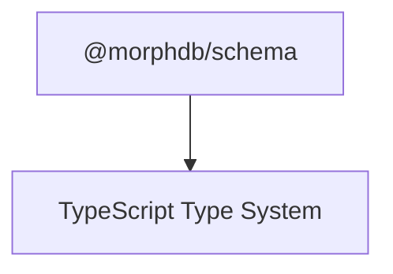

# `@morphdb/schema`

> Universal Schema Intermediate Representation (IR) and Primitive Field Builders for MorphDB.

---

## 1. Responsibility
The `@morphdb/schema` package provides the declarative schema primitives for **MorphDB**. It is responsible for:
- Defining polyglot entity schemas (`defineSchema`) that map cleanly to both SQL DDL (`CREATE TABLE`) and MongoDB BSON document validation schemas (`$jsonSchema`).
- Exposing portable primitive field builders (`field.uuid()`, `field.string()`, `field.int()`, `field.dateTime()`, `field.json()`, `field.boolean()`).
- Inferring compile-time TypeScript entity interfaces (`InferEntity<typeof Schema>`).

---

## 2. Public API

```typescript
export function defineSchema<TShape extends RawSchemaShape>(
  entityName: string,
  shape: TShape
): EntitySchema<TShape>;

export const field: {
  uuid(): FieldBuilder<string>;
  string(): FieldBuilder<string>;
  int(): FieldBuilder<number>;
  dateTime(): FieldBuilder<Date>;
  json<T = Record<string, unknown>>(): FieldBuilder<T>;
  boolean(): FieldBuilder<boolean>;
};

export type InferEntity<TSchema> = ...;
```

---

## 3. Folder Structure

```
packages/schema/
├── package.json
├── tsconfig.json
├── README.md
├── src/
│   ├── index.ts          # Barrel exports
│   ├── field-builder.ts  # Primitive field builder class & fluent functions
│   ├── schema-ir.ts      # EntitySchema & defineSchema implementation
│   └── infer-type.ts     # InferEntity static type inferencer
└── tests/
    └── schema.test.ts    # Vitest unit tests
```

---

## 4. Internal Components
- **`FieldBuilder<T>`**: Immutable builder capturing field data types, primary keys, nullability, uniqueness, and default values.
- **`EntitySchema<TShape>`**: Concrete `SchemaIR` implementation holding the entity name and field builder map.

---

## 5. Interfaces

```typescript
export interface PrimitiveDataType {
  type: 'uuid' | 'string' | 'integer' | 'datetime' | 'json' | 'boolean';
}

export interface FieldMetadata<T> {
  readonly dataType: PrimitiveDataType;
  readonly isNullable: boolean;
  readonly isPrimaryKey: boolean;
  readonly isUnique: boolean;
  readonly defaultValue?: T | (() => T);
}

export interface SchemaIR<T = unknown> {
  readonly _type?: T;
  readonly entityName: string;
  readonly fields: ReadonlyMap<string, FieldBuilder<any>>;
}
```

---

## 6. Dependency Graph



---

## 7. Extension Points
- **Custom Field Types**: Extend `FieldBuilder` to support domain-specific composite primitives (e.g. `field.email()`, `field.vector()`).

---

## 8. Design Patterns Used
- **Builder Pattern**: Fluent method chaining (`field.string().primaryKey().optional()`).
- **Flyweight / IR Pattern**: Shared immutable schema IR objects.
- **Phantom Type Pattern**: Static type inference without runtime overhead (`InferEntity`).
